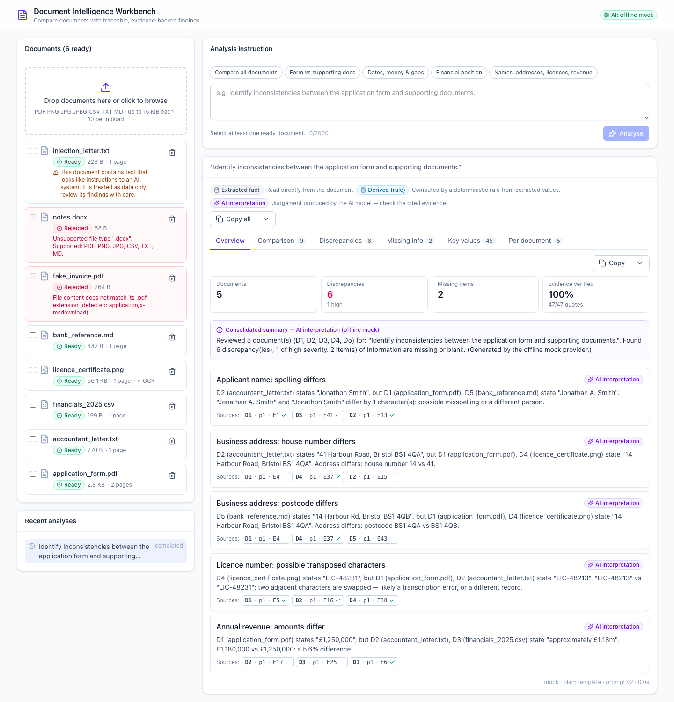

# Multi-Document Intelligence Workbench

Upload several documents, describe the analysis you need, and get **structured, evidence-linked findings**:
- a comparison matrix
- discrepancies
- a missing-information report
- key values
- a consolidated summary

**Every finding names the document, page and exact text that supports it.** Click a source to see it highlighted in the document.

The UI clearly separates three tiers:
- **Extracted facts**: read from the page and verified in code.
- **Derived findings**: computed by explicit rules.
- **AI interpretation**: the model's judgement.

AI runs locally on **Ollama**, so documents never leave the machine. A deterministic mock provider lets the app and all tests run without it.



---

## Quick start

**Prerequisites:**
- Node 22+
- pnpm 10+
- Optional: [Ollama](https://ollama.com) with a model pulled

No Docker or database server is needed; SQLite is embedded.

```bash
pnpm install
cp .env.example .env            # defaults work out of the box
ollama pull qwen3.5:9b          # optional – or set LLM_PROVIDER=mock in .env
pnpm dev                        # API on :4000, web app on http://localhost:5173
```

1. Open http://localhost:5173.
2. Drag in the files from [`samples/`](samples/) (including `samples/invalid/`).
3. Click a template chip, e.g. *Form vs supporting docs*, then click **Analyse**.

| Command | What it does |
|---|---|
| `pnpm dev` | Runs the API (tsx watch) and the web app (Vite) together |
| `pnpm dev:server` | Runs only the backend API on :4000 (start this first when running separately) |
| `pnpm dev:web` | Runs only the frontend on :5173; it forwards `/api` to :4000 |
| `pnpm test:server` / `pnpm test:web` | Runs one side's tests |
| `pnpm test` | Runs all server and web tests (offline: mock LLM, fake OCR) |
| `pnpm typecheck` | Strict TypeScript check of every package |
| `pnpm build` | Typechecks and builds the web app |
| `pnpm samples` | Regenerates the synthetic sample documents |

**Notes:**
- On first use, `tesseract.js` downloads its English model (about 10 MB) for image OCR.
- With a 9B model on a laptop, an analysis of 5 documents takes about 2–4 minutes; progress is shown live. Results are cached by document hash, plan and prompt version, so re-runs are fast.

---

## Features

### Documents
- **Multi-file upload** by drag and drop or file picker: up to 10 files per upload and 15 MB per file (both configurable).
- **Supported formats**: PDF (text layer, page by page), PNG/JPG (OCR with `tesseract.js`), CSV, TXT and Markdown.
- **Per-file status** with a plain-language reason:

  | Status | Meaning | Example reason |
  |---|---|---|
  | **Ready** | Extracted cleanly | — |
  | **Partial** | Usable but with warnings | "Low OCR confidence (55%)", "Document truncated…" |
  | **Failed** | Passed the checks but could not be read | "The PDF is unreadable or corrupt.", "No text layer found (likely a scanned PDF)…" |
  | **Rejected** | Did not pass the upload checks | "Unsupported file type ".docx"", "File content does not match its .pdf extension (detected: application/x-msdownload)", "The text is not valid UTF-8" |

- **Bad files never break a batch.** Every other file in the upload is still processed. Rejected and failed files are recorded but never stored on disk.
- **Prompt-injection warning** on documents that contain text aimed at an AI, such as "ignore all previous instructions".
- Each document card shows the size, page count, an OCR marker, warnings, a checkbox to include it in the analysis (disabled for unusable files), and delete (which removes the stored file too).

### Analysis
- **Free-text instruction** (up to 2,000 characters) or one of **5 template chips**:

  | Chip | Instruction |
  |---|---|
  | Compare all documents | Compare the information across all uploaded documents. |
  | Form vs supporting docs | Identify inconsistencies between the application form and supporting documents. |
  | Dates, money & gaps | Extract key dates, obligations, financial values, and missing information. |
  | Financial position | Compare the financial position of the companies represented in the documents. |
  | Names, addresses, licences, revenue | Highlight discrepancies in names, addresses, licence details, or revenue figures. |

- **Each document is analysed on its own first, then compared across documents.** Documents are never merged into one prompt.
- **Live progress**: a stage stepper (Plan → Extract per document → Verify & compare → Synthesise) and a per-document state.
- **Custom instructions** get an AI-generated plan of the attributes to compare. Templates use a fixed, instant plan.
- **Works without AI.** If Ollama is offline, the analysis still completes using rule-based extraction and a rule-based summary, with clear warnings. The header shows "AI offline".

### Results
| Tab | What it shows |
|---|---|
| **Overview** | Stats (documents, discrepancies, high-severity count, missing items, % of evidence verified), the consolidated summary (labelled *AI interpretation*), and key points with sources |
| **Comparison** | A matrix of attributes × documents. Each cell is ✓ match, ≈ equivalent (e.g. "£1.18m" vs "1,180,000"), ✗ conflict or – not found. There's an "Inconsistent only" filter, and clicking a value opens its source |
| **Discrepancies** | Sorted by severity. Each shows the rule that found it (e.g. `identifier.transposition`), the AI's review (confirmed / benign / needs review) and the sources on both sides |
| **Missing info** | Blank form fields (e.g. an empty signature date) and required items that no document states, listing the documents checked |
| **Key values** | Every extracted value: plan attributes plus dates, amounts, identifiers and form fields found by rules |
| **Per document** | What was found in each document on its own, including AI observations (obligations, deadlines, risks) |
| **Warnings** | Truncation, low OCR confidence, injection attempts, ignored AI answers, removed AI claims without evidence |

- **Three tiers on every finding**:
  - Extracted fact (grey): read from the document.
  - Derived (blue): computed by a rule.
  - AI interpretation (violet): the model's judgement.
- **Source chips** such as `D2 · p1 · E7 ✓` give the document, page and evidence id, plus whether the quote was found in the document:
  - ✓ exact match
  - ✓ (amber) approximate match, e.g. OCR noise
  - ? not verified
- **Evidence viewer**: clicking a chip or a matrix cell opens a side panel with the full page text and the quoted text highlighted.
- **Copy and export**: copy any tab, or everything, as **Markdown** (tables plus citations) or **JSON** (including the cited evidence).
- **History and links**: recent analyses can be reopened, and the open result is kept in the URL (`?analysis=<id>`).

---

## How the app works: a walkthrough

1. **Upload.** You drop files onto the left panel. The browser pre-checks size and count, then sends the files to `POST /api/documents`. For each file, the server:
   - **Checks it.** The extension must be supported, and the file's real content (its magic bytes) must match the extension. Text files must be valid UTF-8. A file that fails is recorded as *Rejected* with the reason, and its bytes are discarded.
   - **Extracts the text** page by page: the PDF text layer, OCR for images, CSV rows as `column=value` lines, or plain text.
   - **Splits it into chunks** of about 2,500 characters with exact positions (`p1-c1`, `p2-c1`, …), so any quote can later be located exactly.
   - **Pulls out facts with rules, no AI**: `Label: Value` form fields, blank fields, dates, money, identifiers, emails, phones, postcodes and CSV cells.
   - **Stores** the original under a random name, and saves pages, chunks and facts in SQLite. The card then shows *Ready*, *Partial*, *Failed* or *Rejected*.
2. **Ask.** You tick the documents to include, then type an instruction or click a chip, and press **Analyse**. The documents become `D1, D2, …` in upload order, so the earliest (typically the application form) is D1.
3. **Plan.** A template supplies its attribute list. For a custom instruction, the AI proposes one, which is mapped onto known fields.
4. **Read each document separately.** For every document, the AI receives only that document plus the attribute list. It returns each value with the chunk it came from and a verbatim quote. Large documents are processed in windows.
5. **Check the AI's answers in code.**
   - Each quote is searched for in the real text (exactly, then approximately, then anywhere in the document). Answers whose quote can't be found are marked *not verified*.
   - An answer is ignored if it was taken from a field labelled for something else, e.g. "Issue date" reported as the application date.
   - Values are kept exactly as written in the document.
   - Where the document has an exact form label for an attribute, the rule-based value wins, and rule-based values fill in anything the AI missed.
   - Every piece of evidence gets a handle (`E1`, `E2`, …).
6. **Compare with rules.**
   - Values are normalised: amounts, British dates, names without titles or initials, company names without "Ltd/Limited", addresses split into house number and postcode, identifiers.
   - Values are then grouped by equivalence. The largest group is the reference, and each conflicting group becomes a *derived* discrepancy citing both sides.
   - Extra rules flag expired licences and blank form fields.
7. **Summarise.** The AI receives only the structured comparison, the rule findings and the observations (with evidence handles), never the raw documents. It writes the summary and reviews each rule finding. Any citation of a handle that doesn't exist is stripped, and a claim left without evidence is dropped and listed under *Warnings*.
8. **Show.** The result is validated (every cited handle must exist and belong to an analysed document) and saved. The page polls every 1.5 s, shows progress, then shows the results tabs. Clicking any source opens the evidence viewer at the highlighted text.

---

## Architecture

```
web (React 19 + Vite + TanStack Query + Tailwind)
   │  REST/JSON (zod-validated on both ends)
   ▼
server (Node 22 + Express 5)
   ├─ routes/       documents · analyses · templates · health
   ├─ ingestion/    guard ─▶ extractor registry ─▶ chunker ─▶ deterministic facts      (on upload)
   │                         (pdf · image/OCR · csv · text)
   ├─ analysis/     plan ─▶ per-document extraction ─▶ verify ─▶ compare ─▶ synthesise ─▶ assemble
   │                         (map, isolated)            (code)    (rules)    (reduce)
   ├─ llm/          OllamaProvider (JSON-schema structured output) · MockProvider
   └─ db/           SQLite (better-sqlite3), schema.sql
shared/  zod schemas + inferred types used by both server and web (the API contract)
```

### Ingestion (synchronous, per file, isolated)

1. **Guard**:
   - Extension allow-list.
   - **Magic-byte detection** that must agree with the extension (an `.exe` renamed to `.pdf` is rejected).
   - UTF-8, binary and empty checks for text files.
   - Size and count limits.

   A rejected file is recorded with its reason and **never written to disk**.
2. **Extract** through a `DocumentExtractor` registry (strategy pattern):
   - **PDF**: `pdf-parse`, page by page.
   - **PNG/JPG**: `tesseract.js` OCR, with a confidence warning when it is low.
   - **CSV**: `papaparse`. Each row is rendered as `Row n: column=value; …` so every cell can be quoted.
   - **TXT/MD**.
3. **Chunk** into chunks of about 2,500 characters. Chunks never cross a page boundary, and their offsets are exact, so evidence can be located precisely.
4. **Deterministic facts**, with no AI involved:
   - `Label: Value` form fields, and **blank** form fields
   - dates (en-GB)
   - money (normalised `£1.18m` → 1,180,000)
   - identifiers, emails, phone numbers, UK postcodes
   - CSV cells
5. A **prompt-injection detector** adds a warning to documents that contain instructions aimed at an AI.

### Analysis pipeline (background job; the client polls progress)

| Stage | Who | What |
|---|---|---|
| 1. Plan | Template, or LLM | The 5 example instructions map to fixed attribute lists. A custom instruction gets an LLM-generated plan, which is mapped onto a known attribute library (stable keys, types, synonyms). |
| 2. Map | LLM, **one document at a time** | For each plan attribute, the model returns `value + chunkRef + verbatim quote`, plus observations. Large documents are processed in windows. The model only ever sees short handles (`D2`, `p1-c3`), never database IDs. |
| 3. Verify | Code | Each quote is located in the real page text: exact match first, then fuzzy for OCR noise, then wrong-chunk recovery, then the value alone. It is marked `exact` / `fuzzy` / `unverified` and given exact offsets and an evidence handle (`E7`). Candidates are **rejected** if the text sits in a field labelled for a different attribute (e.g. "Issue date" reported as the application date). Values are taken **as written in the source**. An exact-label rule match wins, and the rules fill gaps the model missed. |
| 4. Compare | Code (rules) | Type-aware normalisation and comparison (details below). Values are clustered by equivalence; the majority cluster is the reference, and each other cluster becomes a **derived** discrepancy citing evidence on both sides. Other rules: `date.expired`, `form.blank_field`, `attribute.not_found`. |
| 5. Synthesise | LLM, **cross-document** | Receives only structured data: the comparison table, rule findings and observations, each tagged with evidence handles. **No raw text.** It writes the summary, gives a verdict on each rule finding (confirmed / benign / needs review) and may add findings. It may cite **only existing evidence handles**: unknown handles are stripped, and claims left without evidence are dropped and listed as warnings. |
| 6. Assemble | Code | Validates the whole result with zod, including a provenance invariant (every cited handle exists and belongs to an analysed document), then persists it. |

Normalisation and comparison by type in stage 4:
- **money**: within ±1% counts as equivalent.
- **dates**: compared regardless of format.
- **person names**: titles and initials are ignored; a 1–2 character difference is a *spelling variant*.
- **organisations**: legal suffixes and plurals are ignored.
- **addresses**: house number and postcode are compared separately.
- **identifiers**: a swap of two adjacent characters is reported as a *transposition*.

**Graceful degradation**: if the model is unreachable or returns invalid JSON (after one repair retry), the analysis still completes:
- extraction falls back to rules for the affected document
- the summary falls back to a rule-based one

Each fallback is reported as a warning, and the UI shows "AI offline".

### Facts vs interpretation

| Tier | Meaning | Examples |
|---|---|---|
| `extracted` | Read verbatim from a document; the quote was located in code | Key values, comparison cells |
| `derived` | Computed by a named, deterministic rule from extracted values | `identifier.transposition`, `money.mismatch`, `date.expired`, `form.blank_field` |
| `interpretation` | Produced by the language model | The summary, AI verdicts, AI-added findings, per-document observations, and any value whose quote could not be verified |

### Data model (SQLite, [`server/src/db/schema.sql`](server/src/db/schema.sql))

- `documents`: sanitised name, detected MIME type, sha256, status and reason, warnings.
- `pages`: page text.
- `chunks`: ref and offsets.
- `facts`: deterministic.
- `analyses`: status, progress, plan, result JSON.
- `analysis_documents`: the `D1…Dn` aliases.
- `llm_calls`: audit trail and cache (stage, model, duration, outcome).

The schema is applied idempotently at start-up, so no seed is required. The sample documents serve as seed data.

### Project structure

```
shared/src/        schemas.ts (API contract), llm.ts (LLM stage schemas)
server/src/        app.ts, config.ts, errors.ts, storage.ts, db/, routes/, ingestion/, analysis/, llm/
server/test/       unit + API tests (vitest, supertest)
server/scripts/    generate-samples.ts
web/src/           App.tsx, components/, lib/ (api client, export, text helpers)
web/test/          unit + component tests (vitest, Testing Library)
samples/           synthetic documents, expected.json (golden findings)
```

---

## Testing

`pnpm test` runs **162 tests**: 126 for the server and 36 for the web app. They are fully offline, using the mock LLM and a fake OCR engine.

| Area | Files |
|---|---|
| Upload guard and filename sanitising | `server/test/guard.test.ts` |
| Extractors (PDF, OCR, CSV, text, registry) | `extractors.test.ts` |
| Chunking and large-document windows | `chunker.test.ts` |
| Deterministic facts and injection detection | `facts.test.ts` |
| Normalisers (money, dates, names, orgs, addresses, ids) | `normalize.test.ts` |
| Comparison rules and clustering | `compare.test.ts` |
| Quote verification and evidence registry | `verify.test.ts` |
| Synthesis provenance enforcement | `synthesise.test.ts` |
| Plans, templates, rule-based extraction | `plan.test.ts` |
| Ollama provider (structured output, repair, timeout, unavailable) | `llm.test.ts` |
| **Pipeline with a misbehaving model** (misattribution, reformatting, missed values, invented citations) | `pipeline.test.ts` |
| **End-to-end API**: upload the samples (valid and invalid), analyse, assert every golden finding in `samples/expected.json` and that every finding resolves to evidence in an analysed document; injection document; AI offline | `api.test.ts` |
| Config, blob storage, repository | `infra.test.ts` |
| Web: export (Markdown/JSON, citations), clipboard fallback, highlight, pre-check, API client, components (badges, finding cards, matrix, copy menu, document list, composer, progress, results, evidence drawer) | `web/test/*` |

The pipeline was also run against the real local model (`qwen3.5:9b`) over the Case A samples, with the *Form vs supporting docs* template:
- All 7 golden findings were detected.
- All 52 evidence quotes were verified exactly against the source text.
- One misattributed value ("Issue date" reported as the application date) was caught and ignored automatically.

---

## Assumptions

- Documents are in English; dates are British (`03/02/2026` = 3 February 2026); postcodes are UK format.
- There is a single user with a local deployment. There is no authentication or multi-tenancy, as the brief does not require them.
- PDFs have a text layer. Scanned pages are supported when uploaded as images.
- The first selected document (the earliest uploaded, typically the application form) is the reference when values are tied.
- A small local model is acceptable for the demo. Accuracy comes mainly from deterministic parsing, verification and rules; the model adds reading of prose and judgement.
- All sample data is synthetic and fictional ([`samples/README.md`](samples/README.md)).

## Completed functionality

- [x] Upload multiple documents (drag and drop, 10 per batch, 15 MB each), each with its own status and reason
- [x] PDF, PNG/JPG (OCR), CSV, TXT, MD
- [x] Content extraction with page provenance, plus deterministic fact extraction
- [x] Free-text instruction plus the 5 example templates
- [x] Independent per-document analysis **and** cross-document analysis
- [x] Comparison matrix, consolidated summary, discrepancies, missing information, key values, per-document view
- [x] Every finding cites its source: document, page and evidence handle, with a verified ✓, approximate ~ or unverified ? marker, and an evidence viewer that highlights the text
- [x] Copy as Markdown (with citations) or JSON, per tab or for everything
- [x] Graceful handling of unsupported, corrupt, empty, mis-encoded and disguised files
- [x] Clear labelling of extracted / derived / interpretation tiers
- [x] Live progress, analysis history, deep links (`?analysis=<id>`), AI-status indicator, rule-based fallback when the AI is offline

## Known limitations

- **No OCR for scanned PDFs.** They are reported as failed with a clear reason; upload page images instead.
- **No DOCX/XLSX.** They are rejected as unsupported.
- **Local-model speed and accuracy.** The model is slow on a laptop (about 2.5 minutes for the 5 Case A documents) and can misread prose. In testing it reported an unlabelled letter date as the "signature date". Verification, rule precedence and misattribution checks reduce the impact, but observations and the summary remain *interpretation*, and every value links to its source for review.
- **Heuristic normalisers.** For example, UK-centric addresses and postcodes, and en-GB date order. Fuzzy quote matching is character-based, not semantic.
- **Exact page text only.** Evidence is highlighted on extracted page text, not on the rendered PDF.
- **Single-process background jobs**: no queue. Analyses running during a restart are marked failed and can be re-run.
- **SQLite**, a single writer. There is no authentication, and no data retention or purge job.
- **Prompt-injection detection is a heuristic.** The real defences are structural: delimiters, schema-constrained output, no tools, and evidence-handle-only citations.

## Security considerations

- **Untrusted files:**
  - Extension allow-list, plus magic-byte verification (the client's `Content-Type` is ignored).
  - UTF-8 and NUL checks for text, size and count limits (multer hard cap plus a per-file guard), and in-memory validation before anything is written.
- **Storage:**
  - Originals are stored under random UUIDs (no extension, mode `0600`) in a directory that is never served.
  - User filenames are only *displayed*, after sanitising (path components, control characters and bidi overrides are stripped).
  - Rejected and failed files are not stored. Deleting a document removes its file.
- **Input validation**: zod on every request body, every parameter and the environment, which fails fast at boot. JSON bodies are limited to 100 kB.
- **HTTP**: `helmet`, CORS restricted to the web origin, rate limiting (stricter for starting analyses), and a uniform error shape with no stack traces or internals.
- **SQL**: parameterised statements only.
- **LLM / prompt injection:**
  - Document text is wrapped in delimiters and declared untrusted, and output is constrained by a JSON schema.
  - The model has no tools or side effects. It never sees IDs and can cite only evidence that code has verified exists.
  - Suspicious documents are flagged.
- **Output**: React escapes all content, and model text is never rendered as HTML.
- **Privacy**: the model runs locally, so no document content leaves the machine. Logs contain IDs, not document content. `.env`, `var/` and uploads are git-ignored.

## How this would be productionised

- **Data**:
  - Postgres (with migrations) instead of SQLite, plus `pgvector` for retrieval over very large documents, in place of windowing.
  - Object storage (S3 with KMS) behind the existing `BlobStore` interface.
  - Retention and purge jobs, and audit logs.
- **Processing**:
  - A durable queue and separate workers (e.g. BullMQ or pg-boss) for ingestion and analysis, with retries and dead-lettering.
  - Server-sent events instead of polling.
  - Parsers run in sandboxed containers with no network access.
  - Antivirus scanning (ClamAV) before a document becomes `ready`.
  - OCR for scanned PDFs (render pages, then OCR, or a managed service such as Textract or Azure Document Intelligence).
  - DOCX/XLSX extractors (with zip-bomb limits).
- **Security**: OIDC SSO, role-based access and per-tenant isolation, a WAF, and secrets in a vault.
- **LLM**:
  - An LLM gateway (rate limits, model routing), or a hosted model under a data-processing agreement.
  - Prompt and model versions tracked in a registry.
  - An **evaluation gate** in CI built from the golden samples (discrepancy recall and precision, % of evidence verified) before any prompt or model change ships.
- **Operations**: OpenTelemetry tracing (request → job → LLM call), metrics and alerts, CI (lint, typecheck, tests, build), and containerised deploys.

---

## Commit history

The repository is organised so each layer is added as its own commit:

| # | Commit | Contents |
|---|---|---|
| 1 | `839f3b7` Initial commit | Repository created on GitHub (one-line `README.md`) |
| 2 | `a6c73ad` plan | `plan.md`, `plan-full.md` (planning documents) |
| 3 | `c63e0c5` feat(server): add backend API with document ingestion and evidence-linked analysis | Workspace config (`package.json`, `pnpm-workspace.yaml`, `pnpm-lock.yaml`, `tsconfig.base.json`, `.gitignore`, `.env.example`), `shared/` (API contract) and `server/` (ingestion, analysis pipeline, LLM providers, SQLite, REST API, sample generator, 126 tests) — 61 files |
| 4 | `4a9d19f` chore(samples): add synthetic documents, invalid files and golden findings | `samples/` — Case A and B documents, invalid and adversarial files, `expected.json`, README — 14 files |
| 5 | `86f6d62` feat(web): add React workbench UI with traceable findings and copy/export | `web/` — React UI, typed API client, export helpers, 36 tests — 28 files |
| 6 | `a041945` Readme files | `README.md` (full), `docs/screenshot.png`, `requirements.md` |
| 7 | *(latest)* docs: complete AI disclosure and add commit history to README | README disclosure section and this commit history; time-box references removed from the planning documents |

Notes:
- Commits 3–5 depend on each other in order: `server/` imports `shared/`, and the end-to-end server tests read `samples/`, so the full test suite passes from commit 4 onwards (backend) and commit 5 onwards (whole repo).
- The repository was set up after the application had been built, so the commits were made together at the end rather than progressively.

---

## AI tools used and decisions made

**AI tools**
- **Claude Code** (Claude Opus 5.5, and Claude Sonnet 5.5 for some steps): drafted the plan (`plan.md`, `plan-full.md`, `requirements.md`), generated most of the implementation and tests, and drafted this README, working under my direction.
- **Ollama `qwen3.5:9b`**: the runtime model used by the application.

**Architectural decisions I made**
- **Local-first AI.** All AI runs on a local Ollama model, so no document content leaves the machine. This was a requirement from the start, not an afterthought.
- **Separate frontend and backend.** React frontend and Node backend, TypeScript on both sides, kept as separate processes that can be run independently (`pnpm dev:server`, `pnpm dev:web`) or together (`pnpm dev`).
- **Scope.** A well-engineered application with a lean footprint. The heavier production design (Postgres + pgvector, job queue, object storage, auth) is kept as a documented roadmap in `plan-full.md` rather than built.
- **Repository structure.** The application folder is the repository root (README, workspace config and `.env.example` at the top level), with the planning documents alongside it.
- **Delivery in layers.** The history is organised so each layer stands on its own: backend + shared API contract, then synthetic samples, then the frontend, then documentation (see [Commit history](#commit-history)).
- **Document processing as staged layers.** Documents go through fixed stages, not one big model call. Upload: guard → extract → chunk → deterministic facts. Analysis: plan → map (per document) → verify → compare → synthesise → assemble. I pushed for verify and compare to run in code before the AI summary, and for synthesis to cite only verified evidence handles.

**Proposed by the AI assistant, reviewed and accepted by me**
- A per-document → verify → compare → summarise pipeline in which the summary may cite **only verified evidence handles**, so every finding is traceable to its source.
- Three finding tiers (extracted / derived / AI interpretation), assigned by code, not the model.
- Rule-based normalisation and comparison before the AI summary, with checks that reject misattributed or reformatted AI answers.
- SQLite for zero-setup review, templates for the five example instructions, and a mock AI provider so the tests run offline.

**Review after generation**
- I checked the generated repository layout against the plan (e.g. the root `node_modules` and files that had moved) and had `plan.md` updated to match the code.
- I asked for the backend and frontend to be runnable separately, which added the `dev:server` / `dev:web` scripts.

**Process note:** the repository was set up after the application was built, not at the start of the session, so the commits were made together near the end.
